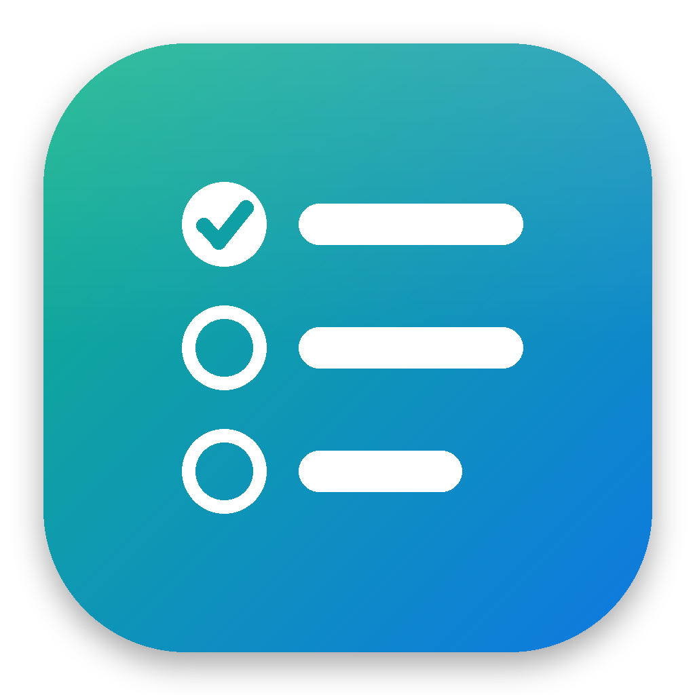

<p align="center">
  
</p>

<h1 align="center">Sysslar</h1>

<p align="center">
  <strong>Your tasks. Your time. Your computer. Nobody else's business.</strong><br>
  A private, offline task manager and time tracker for Windows and macOS. No account, no cloud, no internet required.
</p>

<p align="center">
  
  
  
  
</p>

---

## What is Sysslar?

Sysslar is a small desktop app that sits in your system tray (or the macOS menu bar) and keeps track of
**everything you want to get done**: work projects, personal errands, habits,
goals. It also shows **where your time actually goes**.

It is built around one idea: **your to-do list is personal.** It shouldn't
live on someone else's server, need a subscription, or stop working when the
Wi-Fi drops.

## Why Sysslar exists

Most task apps want you to sign up, sync to their cloud and pay monthly, and
they hold your data. Sysslar takes the opposite approach:

- 🔒 **Private by design.** Everything is stored in a local database on your own computer.
  No telemetry, no analytics, no servers.
- 📴 **No internet needed.** Sysslar never connects to the internet unless you switch on the
  optional update check. It works on a plane, behind a firewall, anywhere.
- 🧍 **Not just for projects.** Use it for your own life: daily routines,
  reminders, learning goals, side projects, chores.
- 📈 **For personal improvement.** Sysslar tracks time spent and tasks completed so you
  can see your own progress and work habits. Only you see the reports.
- ⚡ **Simple and fast.** One click (or one shortcut) adds a task. No setup, no
  tutorial, no clutter.

## Features

### ✅ Tasks
- **One-click add** from the main window, or **Win + Shift + T** (macOS: **Control + Option + T**) from anywhere
- Title, description, due date and **task numbers** (`#012`) for quick reference
- **Groups** with colours (Work, Personal, Health… whatever you like) and one-click group filters
- **Today / This Week / All** views, plus instant search by title, number or description
- **Recurring tasks**: daily, weekly or monthly; the next one is created when you finish the current one
- **Drag and drop** to reorder your list
- **Postpone** a task to tomorrow or next week with one click (⏭)
- **Undo**: completing, deleting or postponing shows an Undo button; **Ctrl + Z** (macOS: **⌘ Z**) works too
- **Recycle bin**: deleted tasks can be restored for 30 days
- Overdue tasks are highlighted in red, so nothing slips quietly

### ⌨ Keyboard shortcuts
- Work without the mouse: **N** new task, **/** search, **↑ ↓** pick a task, **Space** done,
  **E** edit, **T** timer, **P** / **Shift + P** postpone, **Delete** to the bin, **1 2 3** switch views
- Press **?** for the full list. It is also in Settings, and shown in the "Good to know" tips on the first start

### ⏱ Time tracking
- **One toggle** starts the timer on a task, and pause/resume is one click
- **Pauses automatically** when you are idle for 5 minutes, lock your PC, put it to
  sleep, shut down or quit, so your reports stay honest
- Resumes when you come back from idle or unlock
- Add time by hand for tasks you forgot to track
- A **floating mini-widget** shows the running timer while you work in other apps

### 🔔 Reminders
- One-time, daily, weekly (pick the weekday) or monthly (pick the day) reminders, with an optional end date
- Quick **"remind me in 5 / 10 / 30 / 60 minutes"** from any task
- Themed pop-up notifications with **snooze**, custom accent colour and notification sound
- A **missed-notifications inbox**, so reminders that fired while you were away aren't lost
- Reminders and snoozes survive restarts

### 📝 Notes
- Quick notes with **tags** and full-text search, for ideas, how-tos and snippets
- One-click copy of a note's text
- **Attach files to notes**: screenshots, PDFs, documents, anything. Add them from the
  note, paste with **Ctrl + V** (macOS: **⌘ V**) or drag and drop. Notes with files show a 📎 count in the list

### 📎 Attachments
- Attach files to **tasks and notes**
- Paste screenshots with **Ctrl + V** (macOS: **⌘ V**), drag and drop files, or pick them from disk
- Built-in image viewer with next/previous; other files open in their default app

### 📊 Personal progress reports
- Tasks completed **today, this week and all time**
- **Week-by-week charts** of tasks finished and time spent (browse back through past weeks)
- **Your busiest hours** of the day and an average **weekly time pattern**
- **Top tasks by time**, to see where your hours really go
- **Meeting hours**, detected automatically when a calling app (Teams, Zoom, Skype,
  Webex, Slack, Discord, Google Meet…) is actively using your microphone or camera.
  No calendar access or sign-in needed. (Windows only.)
- **App usage**, showing which apps you spend your day in

### 🗂 Workspaces
- Keep **separate workspaces**, for example **Personal** and **Office**. Each has its own tasks, notes,
  groups, reminders, time history, reports, settings and backups, and **nothing mixes** between them
- **Switch from the top of the window**: click the workspace name next to the Sysslar logo and pick
  another one. Sysslar restarts in it in a second or two (a running timer is paused and saved first)
- **Start a new workspace empty, or fill it from a migration file**, for example to bring your work
  tasks from another computer in without touching your personal ones
- Rename, recolour or delete workspaces under **Manage workspaces…** in the same menu

### 🔄 Sync between your computers
- Keep workspaces **the same on all your computers**, Mac and Windows mixed, through **Google Drive,
  iCloud Drive, OneDrive, Dropbox** or any shared folder. No account, and Sysslar itself still never goes online:
  it writes encrypted files into the folder and your cloud app moves them
- **True sync:** new tasks, notes, groups, reminders and attachments are added on every computer, and changes
  are updated everywhere (the newest change wins). Something is removed only when it was deleted on one of them.
  Time tracked on each computer adds up
- **Choose which workspaces sync**, separately on each computer
- **Encrypted before it leaves your computer** (AES-256). The encryption key is kept only on the computers
  where you turn on sync (Windows DPAPI, macOS Keychain). Change it any time: the other computers pause until
  you type the new key, and nothing is lost meanwhile
- Settings → Sync → **Turn on sync**, pick the folder, and type the key on your other computers. That's all

### 💻 Migrate to another computer
- Move **everything** to a new PC in **one password-protected file**: open and completed
  tasks, groups, notes, reminders, task and note attachments, reports history, recycle bin and settings
- The file is **encrypted with your password** (AES-256), so it is safe on a USB stick or shared drive
- On the new PC, pick the file, enter the password, and Sysslar restarts with all your data,
  as if you had never switched computers
- No cloud, no account: the file goes wherever *you* put it

### 🛟 Your data is safe
- **Automatic daily backups** of your tasks, notes and settings; the last 14 days are kept.
  **Settings → Backups** puts an earlier day back (your current data is kept as a safety copy first)
- If Sysslar ever can't start, it shows what went wrong and offers to **restore the latest backup**,
  instead of silently closing
- Every build is tested by opening every page with sample data before an installer is made

### 📤 Export, import and print
- **Export to CSV** (Excel, Numbers, Google Sheets) or **Markdown** (Obsidian, Notion, GitHub)
- **Import tasks from CSV**: your own spreadsheet, a Sysslar export, or another app such as Todoist.
  Only a Title column is needed; groups are created for you
- **Print or save as PDF**: today's list, this week's, or all open tasks

### 🎉 Small things that make it nice
- A celebration with confetti when you finish a task, plus a shareable "completed" banner
  (saved to your Desktop and copied to the clipboard)
- **Dark and light themes** that follow your Windows or macOS setting automatically
- **Larger text** option (Settings → Appearance), and screen-reader names on every icon button
- Optional **update check** (off by default): one anonymous request to GitHub once a day, nothing about you is sent
- Lives quietly in the **system tray**, and opening it again just brings the window forward

## Getting started

### Requirements
- Windows 10 version 2004 (build 19041) or later, 64-bit
- [.NET 10 SDK](https://dotnet.microsoft.com/download/dotnet/10.0) to build from source

### Build and run

```bash
git clone https://github.com/muaa3405-spec/tasky.git
cd tasky
dotnet run --project Tasky/Tasky.csproj
```

That's it. No accounts, keys or configuration. On first start Sysslar creates its own
empty database.

To make a self-contained build you can copy to any Windows PC (no .NET install needed there):

```bash
dotnet publish Tasky/Tasky.csproj -c Release
```

See [BUILD.md](BUILD.md) for building the installer with Inno Setup.

## Where your data lives

Sysslar was called Tasky before, and its folders keep that name, so updating keeps all your data.
Everything stays inside your user profile. Nothing is ever uploaded. On macOS the same files live in
`~/Library/Application Support/Tasky/` (logs, backups and safety copies in `~/Library/Application Support/Tasky Local/`).

| What | Location |
|------|----------|
| Tasks, notes, reminders, reports (SQLite) | `%AppData%\Tasky\tasky.db` |
| Task attachments | `%AppData%\Tasky\Attachments\<task id>\` |
| Note attachments | `%AppData%\Tasky\Attachments\notes\<note id>\` |
| Settings | `%AppData%\Tasky\settings.json` |
| Daily backups (database and settings, last 14) | `%LocalAppData%\Tasky\backups\` |
| Error logs | `%LocalAppData%\Tasky\logs\` |
| Safety copy made before an import or a restore | `%LocalAppData%\Tasky\before-import\` |

The table shows your first workspace. Every other workspace has the same files in its own folders:
`%AppData%\Tasky Workspaces\<workspace id>\` and `%LocalAppData%\Tasky Workspaces\<workspace id>\`
(macOS: `~/Library/Application Support/Tasky Workspaces/` and `~/Library/Application Support/Tasky Local Workspaces/`).
The list of workspaces is `%AppData%\Tasky Workspaces\workspaces.json`.
Sync settings of this computer (its id, the sync folder, which workspaces sync) are in `%LocalAppData%\Tasky Sync\`
(macOS: `~/Library/Application Support/Tasky Sync/`). The sync key is not there: it's in DPAPI (Windows) or the
login keychain as "Sysslar Sync" (macOS).

These folders are readable only by your user account (and administrators).
Uninstalling Sysslar does not remove them. **Remove all data** by deleting `%AppData%\Tasky`,
`%LocalAppData%\Tasky`, `%AppData%\Tasky Workspaces` and `%LocalAppData%\Tasky Workspaces`.

### What gets recorded on your PC

To power the reports, Sysslar also keeps two local logs:

- **Meeting detection** (Windows) checks every 30 seconds whether a calling app is actively
  using your microphone or camera, and records only the start and end time of each
  meeting. It never records audio or video.
- **App usage** records which app is in the foreground (by app name, not what's
  inside the window) and for how long.

Both stay in the local database above and never leave your computer.

## Moving to a new computer

1. On the old PC: **Settings → Migrate to another computer → Open → Export from this computer**.
2. Create a password (at least 8 characters, typed twice — pasting into the confirm field is
   turned off, and **Show password** lets you check it). Optionally tick **Also create a recovery key**
   and save the key it shows. Then choose where to save the file (for example a USB stick).
   It is named like `Sysslar-migration-2026-10-21.taskymigration`.
3. Install Sysslar on the new PC and open **Settings → Migrate to another computer → Import on this computer**.
4. Pick the file, enter the password (or the recovery key), review what's inside and click
   **Import and restart Sysslar**.

Good to know:

- **The password can't be recovered.** The file is encrypted with it (AES-256-GCM, key
  derived with PBKDF2-SHA256, 600,000 rounds), and nothing about the password is stored.
  A wrong password or a damaged or edited file is refused.
- **A recovery key is your only fallback.** If you made one at export, type it in the password
  field instead (dashes and capitals don't matter). Keep it away from the file: anyone with both
  can open it. Files with a recovery key need this Sysslar version or newer to open; files
  without one still open in older versions.
- **Importing replaces the data of the open workspace.** Whatever it had before is kept as a
  safety copy in `%LocalAppData%\Tasky\before-import\`. Your other workspaces are not touched.
  To keep the imported data apart, choose **New workspace…** next to the logo and tick
  **Import a Sysslar migration file into it**.
- Attachments keep working even if your user name is different on the new computer, and you can
  move between Windows and macOS in either direction.

## Contributing

Ideas, bug reports and pull requests are welcome.

1. Fork the repo and create a branch from `main`.
2. Keep pull requests focused; one fix or feature each.
3. Open a pull request. Every change to `main` is reviewed by the maintainer before it is merged.

Please don't commit build output, your database or personal settings
(`.gitignore` already excludes them).

## Code signing policy

Free code signing provided by [SignPath.io](https://about.signpath.io), certificate by [SignPath Foundation](https://signpath.org).

The Windows installer is built from this repository's source by GitHub Actions
([build-installers.yml](.github/workflows/build-installers.yml)) and sent to SignPath for signing.
Only releases are signed, and each one is approved by hand first.

| Role | Members |
|------|---------|
| Committers and reviewers | [Muhammad Aadil](https://github.com/muaa3405-spec) |
| Approvers | [Muhammad Aadil](https://github.com/muaa3405-spec) |

Changes from anyone outside the team arrive as pull requests and are reviewed before they are merged.

## Privacy policy

This program will not transfer any information to other networked systems unless specifically
requested by the user or the person installing or operating it.

**Sync** (Settings → Sync, off until you turn it on) doesn't go online either: Sysslar writes
encrypted files into a folder you pick, and your own Google Drive, iCloud, OneDrive or Dropbox app
moves them. The files can't be read without the key, which stays on your computers.

The one feature that goes online is the **update check**, which is off until you switch it on in
Settings → Updates. It then asks GitHub's public API for the latest release number once a day; the
request contains no information about you, your computer or your tasks. Everything else, including
tasks, notes, time tracking, app usage and meeting detection, stays in the local folders listed
under [Where your data lives](#where-your-data-lives).

## License

[MIT](LICENSE) © 2026 Muhammad Aadil
